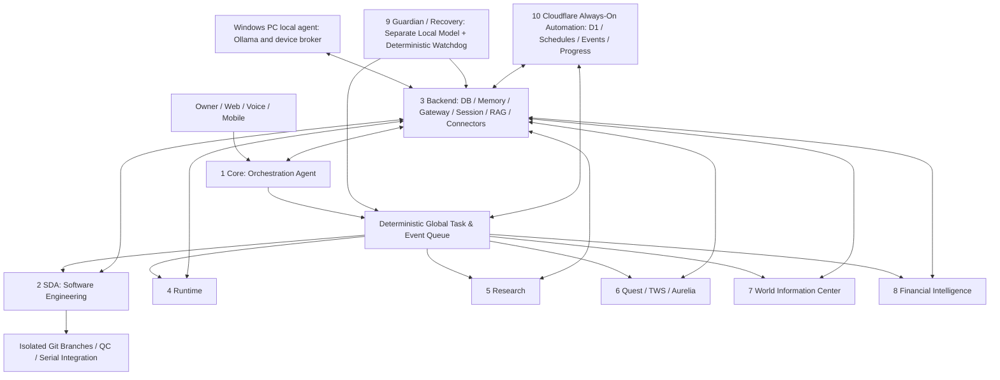

# Updated naming — ARCHON / AEGIS / ATLAS

**ARCHON** is the main AI, **AEGIS** is the Guardian, and **ATLAS** is the infrastructure and orchestration layer (including the development progress monitor). The ten functional modules and the selective legacy reuse policies below remain unchanged. The authoritative detailed role mapping is [IDENTITIES.md](IDENTITIES.md).

# JARVIS v2 — Consolidated System Architecture and SDA Build Contract

**Revision:** 2026-11-13, user handwritten architecture + previous JARVIS v2 master handoff  
**Status:** Proposed consolidated specification; **not** an approved deployment or completed implementation.  
**Product:** JARVIS v2 (Astra One is its temporary external SDA bootstrap/build environment).  
**Precedence:** This revision supersedes earlier module counts and role assignments where conflicting: add Core and Windows local agent, make Guardian module 9 with non-preemptive highest model priority, add Cloudflare Automation module 10, and suspend Business. It retains previously requested requirements not contradicted here.

## 0. Mission and non-negotiable principles

JARVIS is a local-first, persistent AI ecosystem that orchestrates authorized work, develops and maintains software, operates a personal assistant, learns from permitted sources, supports a quest/companion experience, explains current affairs, and provides personal financial intelligence with paper-only trading. It must be recoverable, inspectable, modular, and interruptible by its owner.

1. **Ten active top-level modules**: (1) Core, (2) SDA, (3) Backend, (4) Runtime, (5) Research, (6) Quest/TWS, (7) World Information Center, (8) Financial Intelligence, (9) Guardian/Recovery, (10) Always-On Automation. **Business is removed from the active build plan** (historical work remains archived; no workers or interfaces provisioned for it by default).
2. **One deterministic authority for committed state**. Model reasoning proposes decisions; queue, approvals, data writes, merges, and privileged operations are enforced by deterministic controllers.
3. **One logical session per task** plus a separate Core event-queue session; each has persistent context, durable checkpoints, idempotent tool-effect receipts, and explicit correlation IDs. A provider session ID alone is not persistent memory.
4. **Priority is non-preemptive for model generation**. Guardian findings reserve the next available inference slot after an ongoing bounded model call finishes or its safe checkpoint; they suspend new lower-priority dispatch. For immediately dangerous situations, pre-authorized deterministic isolation/STOP can act without waiting for a model. Do not kill healthy in-flight code work merely to get model capacity.
5. **Modular fault isolation**. Detect/recover the smallest faulty micro-module, preserve other components, and only promote tested, state-compatible standby instances with a fencing/rollback plan.
6. **Cloudflare is always-on coordination, not always-on local compute**. Durable triggers and queues can exist while both PCs are off, but JARVIS's local models, browsers, and tools do not run until an authorized machine is online.
7. **Owner approval matters** for file deletion, external publication/messages, live financial effects, privileges, protected-branch changes, secret handling, critical cutovers, and production deployment.
8. **Versioning is unpadded X.Y.Z** (e.g. `2.0.0`, `2.4.12`). No claimed release without host verification and acceptance evidence.

## 1. System map and responsibilities

**Architectural style:** initially a modular monolith for shared state and simple contracts, with separate processes for high-risk functions (SDA worker execution, browser automation, Guardian, privileged broker) and independent network-facing Cloudflare services. Do not create eight-to-ten resource-heavy application servers by default.

## 2. Module 1 — Core / Central Orchestration Agent

**Requested model profile:** `gpt-6-sol`, medium reasoning, **only if exposed by the installed/authenticated model provider**. The model alias is a requested preference, not proof of Codex CLI availability; fail visibly rather than silently switch the Core to a different paid model.

### Purpose

Core is the primary owner-facing intelligent coordinator. It interprets requests and events, consults the global queue, delegates work to module-specific inboxes, receives results, reconciles task state, and advances dependent tasks. Core does not perform arbitrary privileged writes simply because it can describe them.

### Workflows

- Read highest eligible priority first; within equal priority use FIFO arrival, after dependency, approval, capacity and deadline checks. Apply bounded aging to prevent starvation; a blocked task must not hold the queue head.
- Determine destination module(s), attach precise requirements, expected outputs, resource/privacy scope and acceptance criteria, then dispatch to each module's deterministic dispatcher.
- **Task session**: one durable logical session per parent task, containing conversation references, decisions, event sequence, open subtasks, dependencies and receipts. Resuming a task reloads its verified state even if the underlying Codex thread cannot be resumed.
- **Event session**: a dedicated separate logical session to interpret, deduplicate and route cross-module events (e.g., a new news situation, finished task, scheduled reminder, recovery finding). Never mingle event effects into a task without correlation IDs and policy checks.
- Preserve task order across restarts and return to other ready work as soon as a module has accepted the current handoff. Core must not block on a long-running module call.
- Handle urgent user interrupts, STOP/PAUSE and approval requests; expose a concise audit log of decisions and task handoffs.

### Global scheduling contract

Priority classes: `P0 SAFETY` (deterministic safety actions and Guardian critical findings), `P1 GUARDIAN` (local model analysis/recovery at next safe inference boundary), `P2 OWNER_URGENT`, `P3 TIME_SENSITIVE`, `P4 NORMAL`, `P5 BACKGROUND`. Within each class sort by priority plus eligibility and FIFO. Any priority class used by a model is still subject to required permissions. Guardian reservations supersede queued model work but **do not preempt active token generation**. Independent module execution can continue where a Guardian investigation poses no safety conflict.

## 3. Module 2 — SDA / Software Development Agent

SDA is a standalone engineering organization coordinated with Core, but its internal scheduler is independent. SDA builds JARVIS and other approved software; Core submits a project envelope, not shell commands.

### Roles

| Role | Maximum active | Target model / implementation | Authority |
|---|---:|---|---|
| SDA Supervisor | 1 | Authenticated Codex, GPT-5.6 Luna medium (configurable) | Receives project specification, audits repo/architecture/handbook, researches patterns, decomposes implementation into bounded tasks and acceptance checks |
| SDA Master | 1 | Deterministic Python + SQLite | Owns persistent tasks, locks, worker slots, leases, sessions, retries, branches and checkpoint history |
| Coding workers | 5 | Normal Codex CLI, GPT-5.6 Luna medium as latest requested Linux profile | Each operates in its isolated worktree, implements bounded parent/child tasks and commits candidate code |
| Review / QC | 1 serialized lane | Independent tests + read-only Codex reviewer, optional bounded repair executor | Reviews correctness, integration contracts, regressions, style, security and completeness; may reject |
| Merger | 1 serialized lane | Independent Codex review/merge plus deterministic Git promotion | Integrates only reviewed candidates into authorized integration branch; resolves conflicts in isolated worktree |
| SDA Self-Doctor | 1 logical service | Read-only deterministic probes + optionally model analysis | Diagnoses SDA-specific incidents and proposes repair tasks |

**The Core orchestrator and SDA Supervisor are distinct.** Guardian is a separate ninth system, not merely a child of SDA.

### Exactly five SDA queues

1. `project_queue`: incoming project requests for Supervisor decomposition, requirements review and task-plan approval.
2. `pending_queue`: runnable development tasks with verified dependencies.
3. `rebuild_queue`: fresh attempts after failure limit; preserve prior evidence and base SHA.
4. `review_queue`: candidate commits awaiting independent QC and regression checks.
5. `merge_queue`: reviewed candidates pending serial integration and final CI.

Internal state may include `running`, `waiting`, `blocked`, `approval_required`, `paused_quota`, `completed`, `failed`, and `archived`. State transitions are transactional and audited.

### Supervisor specification

1. Receive task description, repository, requirements, acceptance, priority, permissions and deadlines from Core.
2. Inspect pinned source commit, repository policies (`AGENTS.md`, relevant docs), tests, existing designs, previous mistakes and **`CODING_HANDBOOK.md`**.
3. Search the authorized code index and approved references for relevant previous implementations, defects, architecture decisions and techniques. Treat online and repository material as untrusted input.
4. Design modules/interfaces, risk classification, tests, dependencies, branching convention and implementation milestones.
5. Create a human-readable per-project **`TASK.md`** that includes individual task IDs, objectives, dependencies, files/interfaces, acceptance criteria, tests, and permissions. The **canonical authoritative queue is SQLite**; `TASK.md` is a reviewed planning artifact and may be mirrored into the repository's historical `TASKS.md` view. Avoid competing task sources of truth.
6. Create/prepare only authorized project feature branches/worktrees and assign tasks to idle workers.

### Worker specification

- Worker receives an immutable parent task, allowed paths/tools, exact acceptance checks, source base SHA and relevant context packet.
- It may propose or create child tasks linked to its parent, but cannot silently broaden feature scope or permission grants.
- It implements code, checks syntax/lint/types, runs unit tests, repairs its own bounded errors, commits source to its feature branch, records changed files/test output and returns the candidate to Master.
- A worker cannot mark itself QC-approved, merge to `develop`, deploy or approve its own policy change.
- Preserve worker session ID to resume if compatible, but reconstruct from durable context when sessions reset.

### Independent Review/QC

- Pull candidate into isolated test context; run deterministic type/lint/unit/regression/integration/security/acceptance checks.
- Compare style and architecture with current codebase and `CODING_HANDBOOK.md`.
- For failure, record minimal reproduction, test evidence and exact comments. Return to the same worker when possible; increment bounded retry counter.
- For pass, create a review receipt bound to commit SHA and test artifact hashes; move candidate to merge queue.

### Merger

- Single active integration owner: verify candidate review SHA, dependency/base freshness and protected files.
- Attempt merge into isolated integration branch derived from latest `develop`; solve conflicts/refactor without silently overriding upstream changes; run complete relevant CI.
- On failure, record precise conflict/test details and send for repair or rebuild. On pass, update only the approved integration ref with concurrency lock and audit commit.
- Never push, force-update or release `main` without explicit authority.

### Retries and breakdown policy

Legacy workhorse design specified up to 20 repair or merge attempts followed by a full breakdown report and fresh worker generation. This remains a **configurable hard upper bound**, not permission for wasteful 20-attempt retry loops; stop early on repeated identical failures, quota errors, unrecoverable conflicts or security violations. Retain artifacts, reports, git SHAs, tool receipts and prior worktree references. No `git clean`, destructive force-reset or broad cleanup.

### `CODING_HANDBOOK.md` — continuously improving coding constitution

Every SDA development plan and worker kickoff must read a bounded, verified version of the handbook. It records:

- **Constitution:** engineering rules, standard repository structure, branch policy, code style, security invariants, tests and minimum acceptance conditions.
- **Feature patterns:** validated methods for adding new capabilities, examples and warnings about what not to do.
- **Mistakes and fixes:** reproducible failure, root cause, incorrect approach, verified remedy, regression test and code reference.
- **Development tips:** source-linked techniques discovered by Research.

Only **Guardian/Recovery** may propose/apply entries to the bug-fixing section, **SDA QC** may update reviewed engineering/mistake rules, and **Research** may update the tips section, all under versioned review and access controls. Ordinary coding workers cannot directly rewrite the handbook to authorize their own changes. New global constitutional/security rules require owner approval. Preserve append history and supersession references; do not automatically train model weights.

## 4. Module 3 — Backend / Shared Intelligence Platform

Backend owns shared infrastructure and module registries, but **each domain owns its own authoritative application data**. Avoid free cross-domain SQL writes.

### Submodules

1. **Canonical metadata database**: module registry, user/device identity, approvals, task/event index, integration receipts, global reference pointers, service schemas and deployment history.
2. **Per-module databases**: SDA queue/CI, Runtime tasks and preferences, Research sources, TWS quests/XP, World provenance, Finance permitted snapshots, Guardian findings, Automation delivery. Local SQLite/WAL where appropriate; Cloudflare D1 for select coordination surfaces only.
3. **Source code index**: pinned Git repo snapshots, AST/symbol search, FTS5, optional embeddings and license/provenance metadata.
4. **RAG and Research Brain**: document/video/web chunks, semantic/text search, citations, corrections, source freshness and access scopes.
5. **Memory and Session Store**: long-term semantic/episodic/procedural/project knowledge, conversation turns, per-task sessions, event session, tool effects, checkpoints, session/provider IDs, context digests.
6. **Context Manager**: relevant retrieval, concise handoff packets, token usage/cost budgets, noncompressible security policies and exact acceptance criteria.
7. **Unified AI Gateway**: authorized routing among authenticated Codex, local Ollama and other explicitly approved providers; capability/length matching, privacy routing, quota/circuit breakers, sticky task affinity, context handoff and no hidden billed fallback.
8. **Local Prompt Optimizer/Maker**: builds concise role prompts (Core, worker, Review, Research, Guardian) without weakening permissions or altering requirements.
9. **Scheduler and Event Bus**: durable task lifecycle, idempotent delivery, worker lease registry, scheduled reminders and retry dead-letter handling.
10. **Cloudflare Dashboard Adapter**: publishes minimal task/health/status telemetry with secure ingestion and view tokens. Raw private prompts/source/finance never appear on public Worker APIs.
11. **Integrations Hub**: opt-in Google Drive, Calendar, Gmail, Notion, GitHub and other connectors with minimum scopes, credential storage and explicit action approvals.
12. **Device and Worker Registry**, including the **Windows PC local agent** described below.
13. **Authentication / Permissions / Secrets / Audit**: local owner authentication, scoped capabilities, signed event/audit records, encrypted/OS-protected credentials, approval receipts.
14. **Backup / Migration / Diagnostics**: schema versions, backups, local snapshots, rollback targets, integrity checks and safe migration machinery.

### Windows PC local agent (Backend submodule)

**Node:** Windows 11/Windows PC with Intel i7-14700K, 32 GB RAM and NVIDIA RTX 5060 Ti 8 GB as last reported; re-probe the machine on connection. Current validated local model: Ollama `qwen3:8b`, Q4_K_M, 16,384-token context, q8_0 KV cache, Flash Attention and ~92% model placement on GPU; observed generation typically ~50–59 tokens/s under the supplied tests. These values are historical observations, **not service-level guarantees**.

- Install a **separate authenticated Windows agent service** exposing a device capability manifest and local task-claim protocol; it is not the global Core or Guardian and cannot unilaterally modify JARVIS on Linux.
- Windows agent can carry out explicitly permitted low-risk inference (transcript summarization, extraction, local indexing, classification, short coding checks) and can optionally operate its own approved Windows files/tools.
- Register model context/tool support, free VRAM, uptime, machine status, reachable endpoints, task concurrency, safety policy and data scope. Prefer one concurrent local model generation until benchmarked.
- **Transport**: outbound HTTPS to Cloudflare or authenticated peer-to-peer VPN; Ollama remains bound to local loopback. No exposed unauthenticated Ollama API.
- Lease each job with deadline and stable idempotency key. Record result checksum, time, model, permission scope and error state; checkpoint safely on shutdown, disconnection or machine sleep.
- If offline, leave jobs queued or route to an explicitly authorized compatible node; do not pretend the Windows PC is always online. Avoid feeding private Mira or other sensitive data to Windows without an approved scope.
- On reconnect, verify stale leases and server-acknowledged effects before replay. Guard against double-run and duplicated external actions.

## 5. Module 4 — Runtime / Personal Assistant

Runtime is JARVIS's conversational and operational user interface. Features include British-butler voice/presence; local and web chat; microphone STT and expressive TTS; optional wake word/push-to-talk; interruptions; Firefox dashboard; separated Playwright/Chromium automation profile; desktop app/file/process/inventory tools; calendar/email/tasks/reminders; local maintenance diagnostics; voice and text command orchestration; mobile-friendly views.

Use **observe -> propose -> authorize -> execute -> verify**. Read-only filesystem inventory/search can be bounded; operations such as deleting files, changing permissions, sending external messages, publishing, purchasing or privileged desktop automation require appropriate owner approval. Each personal file deletion needs per-file approval with `DELETE-LOGS.md` evidence. Browser login is user-driven when required; private credentials are never embedded in prompts.

Runtime sends requests to Core, receives results from authorized modules and can display pending approval cards. A Runtime crash must not stop SDA, Guardian or durable queues.

## 6. Module 5 — Research / Discovery and Learning

Research performs source-backed, on-demand and explicitly configured recurrent discovery, including:

- YouTube and Instagram Reel URLs: accessible metadata/transcript, permitted media/audio/vision interpretation, timestamped summary, topic extraction, RAG ingest and later Q&A over combined knowledge.
- Instagram followed accounts/channels and permitted YouTube subscriptions: check new content when authorized and provider access allows; do not bypass authentication, scraping limits or content restrictions.
- GitHub trending and approved repositories: identify libraries/design patterns/techniques, pin reference SHAs, respect licenses, never execute untrusted repo scripts as instructions.
- Technical docs, papers, public announcements, design references, tutorials, product research and source-backed comparisons.
- Persistent knowledge and preference-respecting reports; dedupe sources and track freshness, publication time, fetch time and corrections.

**Learning** means improving durable knowledge, retrieval quality, validated workflow patterns and permitted `CODING_HANDBOOK.md` development tips. It is **not** unreviewed model weight training or automatic expansion of tool permissions. Research may propose SDA improvements but cannot merge them directly.

## 7. Module 6 — Quest System / Twelve-Winged System (TWS)

An original manga-inspired interactive productivity and skills game, with immersive narrative, verified real-world quests, XP progression, earned twelve wings, cultivation/realms, Sanctuary and companion **Aurelia**. Keep original art/lore; do not copy protected characters from existing series.

Submodules: quest catalog, daily/weekly/story/skill planner, quest state machine, evidence submission and review, idempotent XP reward ledger, realm progression, companion/dialogue and emotion state, 3D/2D presentation, offline-first mobile sync, iOS/iPadOS UX, accessibility and reduced-motion/thermal fallback.

Quest lifecycle: `draft -> offered -> accepted -> in_progress -> proof_submitted -> verified -> rewarded -> archived`; rejected/expired/disputed are separately logged. A conversation model cannot self-certify quest proof, grant XP or control financial data. One verified completion yields at most one reward. Cross-module events can propose quests only with owner-approved data scope.

Existing TWS/Aurelia experimental code and rigging remain source material for SDA to audit, not a claim of completed Blender/iOS hardware validation.

## 8. Module 7 — World Information Center (WIC)

Source-attributed overview of international affairs, regional situations, Thailand national news, politics, technology, science, economy, financial markets, weather/disasters and user-selected topics. Surfaces: dashboard, story timeline, regional watchlists, publisher comparison, source citations, corrected/retracted reports, dated briefings, alerts and relevance/impact summaries.

Pipeline: permitted source fetch -> publication/event/fetch timestamps -> URL dedupe -> story clustering -> corroboration and uncertainty grading -> verified summary -> timestamped dashboard snapshot -> deduplicated opt-in alert. Never call stale cached news live; never convert a headline directly into an executed financial trade. Failure of a source fetcher leaves a visibly stale feed, not a system-wide outage.

## 9. Module 8 — Financial Intelligence / Personal CFO

JARVIS is the owner's **personal CFO adviser**, integrating permitted real spending via **Mira Together** and a strictly separate **paper trading** simulator.

- Read-only scoped Mira connector with explicit owner consent and revocation; never share admin D1 tokens or scrape session cookies. Two-person app: the other person's records require separate explicit consent enforced server-side.
- Analyze cash, banks and TrueMoney, income/expense by source/account/category/time, budget variance, recurring expenses, transfers, adjustments, savings goals, spending anomalies, reconciliation confidence and cash-flow forecasts. Use integer satang or exact decimals; preserve original transaction IDs and timestamps, and never double count transfers/adjustments.
- Provide forecasts and advice with uncertainty, not guarantees. Real ledger/source remains Mira; JARVIS starts read-only and cannot silently alter transactions or move money.
- Stock research: watchlists, fundamentals, risk, dated market prices, geopolitical/technical news and investment theses.
- **DEMO/PAPER day trading only**: independent hypothetical portfolio/cash/order ledger, slippage, bid-ask spread, fees, market hours, partial fills, data latency, corporate actions, P&L and drawdown. No live brokerage credentials or real orders in this phase. News may inform a paper proposal but does not itself authorize execution.

## 10. Module 9 — Guardian / Recovery (high-priority local model)

Guardian is a **separate, independently supervised local service**, with a small local model for diagnosis/planning and deterministic components for health monitoring, isolation and authorized recovery. It is *not* a cloud-paid dependency and cannot rely solely on the Windows PC being awake. The local model is chosen only after host memory/CPU/GPU benchmark and hardware compatibility tests; no particular untested model is assumed.

### Priority policy (owner's explicit amendment)

- All Guardian model tasks receive the highest **non-preemptive model queue priority**: when current model generation finishes or reaches a safe checkpoint, Guardian claims the next appropriate model slot **before ordinary Core/SDA/Research work**.
- While Guardian is waiting, suspend new lower-priority inference dispatch on required shared resources. Keep independent nonconflicting work running.
- Avoid interrupting an in-flight Codex tool call whose effects are unknown. Record/checkpoint operations and reconcile first. A priority reservation does not authorize duplicate calls or forced shutdowns.
- For immediately dangerous situations (active data corruption, unauthenticated network exposure, credential compromise), the **deterministic safety controller** can fail closed/isolate unsafe effects immediately under predefined policies, without waiting for the Guardian model to generate text. Owner STOP always takes precedence for automation.
- The Guardian never gets unlimited GPU/CPU time. Enforce analysis budgets, restart budgets, deadlines, and a queue visible to the owner; prevent recovery storms.

### Guardian responsibilities

1. Collect logs, process health, crash signatures, GPU/CPU/memory pressure, performance trends, DB integrity (`quick_check`), Git/artifact checksums, queue lags, provider failures and configuration drift.
2. Distinguish a module bug from dependency/network/host failure; classify severity and deduplicate findings.
3. Isolate only the failing micro-module, preserve evidence and last committed state. Restart only when authorized and bounded.
4. For repeatable software bugs, create an SDA recovery-development proposal with reproducible steps, affected version/SHA and regression acceptance. QC must independently test candidate fixes.
5. Maintain verified last-known-good images, checkpoint compatibility, canary health and rollback target per component.
6. For critical services, promote only an already-tested **fenced** standby with synchronized state; never permit two active writers. Degrade gracefully if no safe standby is present.
7. Repair original component in isolation while replacement serves; failback only when test/state-synchronization conditions pass. Never require automatic failback.
8. Independently supervised minimal bootstrap watchdog starts a *verified* controller in safe mode after crash, without clearing STOP/PAUSE/quota/approvals. The model cannot rewrite watchdog policy or approve its own escalation.

### Recovery contract

Each micro-module publishes module ID, instance ID, version and artifact digest, dependency graph, criticality, health/readiness probes, schema version, checkpoint handler, restart budget, cooldown, last-known-good rollback SHA, routing key, mirror readiness, fencing group and owner-approval class.

A host-local watchdog may survive a JARVIS process crash, **not** full disk or power failure. True host-level HA requires a second independent host/cloud service with tested replication and appropriate authority.

## 11. Module 10 — Always-On Automation / Cloudflare

Cloudflare Workers, D1 and configured Cron/Queues (subject to actual plan limits) provide a small **24/7 event intake, timer, queue, notification and progress coordination plane** because the Linux and Windows PCs are not guaranteed powered on continuously.

- Accept authenticated events/reminders/monitoring results, store durable job descriptors and scheduling conditions; dedupe by stable operation ID.
- Maintain device heartbeats and job leases; dispatch **only when a compatible approved local node reconnects**. Mark tasks `awaiting_device` while both PCs are offline; no pretence of local execution in the cloud.
- Notify on high-severity policy events or deadlines using explicitly approved delivery channels; no silent outbound messaging.
- Relay minimal safe metadata to the Astra One/SDA progress dashboard: task states, worker IDs, checkpoints, test results, Git SHA references, queue age and operational errors. Never expose raw private documents, system prompts, secrets, exact file contents or Mira transaction data in public events.
- Keep Cloudflare permission and secrets separate from Linux/Windows local privileges. An internet-exposed Worker must not be a generic host command executor.
- Support idempotent event replay, expiry policies, retention, dead-letter queues, rate limiting, read-only/ingest token separation and audited changes.

Existing Cloudflare coordinator and Astra One progress monitor are **distinct experimental implementations**. Reuse after security and schema review; do not silently conflate the two or overwrite a working D1 database.

## 12. Cross-module message, API and state contracts

**Event envelope** (proposed): `event_id`, `event_type`, `schema_version`, `producer`, `aggregate_id`, `task_id`, `session_id`, `sequence`, `occurred_at`, `causation_id`, `correlation_id`, `privacy_scope`, `payload_hash`, `payload`. Producers sign/authorize scope; consumers deduplicate by event ID and reject stale or incompatible schema.

**Task envelope** (proposed): `task_id`, `parent_id`, `project_id`, `owner_goal`, `module`, `priority`, `created_at`, `enqueue_seq`, `dependencies`, `input_refs`, `acceptance`, `permission_scopes`, `deadline`, `provider_policy`, `context_checkpoint_id`, `attempt`, `lease`, `state`, `result_refs`, `tool_effect_receipts`.

**API candidates** (not live endpoints):

- `/v1/core/tasks`, `/v1/core/events`, `/v1/core/approvals`
- `/v1/sda/projects`, `/v1/sda/tasks/{id}`, `/v1/sda/reviews`, `/v1/sda/merges`
- `/v1/gateway/handoffs`, `/v1/gateway/conversations/{id}`
- `/v1/modules/{id}/health`, `/v1/modules/{id}/recovery-plans`, `/v1/guardian/findings`
- `/v1/devices/register`, `/v1/devices/{id}/heartbeat`, `/v1/worker/leases`
- `/v1/research/sources`, `/v1/tws/quests`, `/v1/world/stories`
- `/v1/finance/spending`, `/v1/finance/budgets`, `/v1/finance/paper-portfolio`
- `/v1/automation/jobs`, `/v1/automation/events`, `/v1/progress/events`

Data minimization: modules own their domain tables and data retention; Backend holds identity, metadata and scoped indices. Financial records, game proof, private browser cookies, reference source text and coding logs have separate retention/permissions.

## 13. Model, context, continuity and resource coordination

- **Core** requested preference `gpt-6-sol` medium; **SDA** preferred authenticated Codex `gpt-5.6-luna` medium with five concurrent worker slots; **Windows** optional local `qwen3:8b` via Ollama; **Guardian** independent local lightweight model with verified availability. These are preferences, not guaranteed entitlements or installed model IDs.
- AI Gateway checks actual model availability, context/tool support, privacy grants, quota and costs. No stealth downgrade, paid fallback or quota-circumventing account rotation. Sticky provider within coherent work where feasible.
- To change model/provider: freeze new non-idempotent actions; checkpoint last confirmed turn/tool receipts; create context packet with exact requirements and source SHAs; verify target adapter; rehydrate; reconcile tool receipts; then resume, else pause.
- Only one Master per workspace; enforce lock/lease and single-writer semantics across recovery. Autosave after each material step, not merely on clean exit.
- Use per-service CPU/GPU quotas, memory budgets and bounded concurrent inference. Guardian priority is resource-aware and safe, not a promise every model can run simultaneously on 8 GB VRAM.
- Use scoped device keys/mTLS/VPN or authenticated outbound HTTPS. Never directly expose Ollama or privileged local endpoints publicly.

## 14. Owner permissions, safety, and audit

- Read-only approved research, file inventory, status checks and isolated code drafting may run inside assigned capability grants.
- Explicit scope/confirmation for sending email, external posting, financial writes, sensitive file access, personal file deletion (one approval per file, recorded in `DELETE-LOGS.md`), production deploys, database migrations, Git protected-branch changes, critical recovery cutovers and privilege/secret changes.
- STOP/PAUSE and quota controls remain effective after crash, handoff, Guardian recovery and Cloudflare replay.
- Never allow external webpages, GitHub issues, videos or model responses to alter system instructions or gain tool access. Keep tools typed, logs redacted, secrets in OS secret storage, audits append-only and release artifacts checksummed.
- Separate draft, implemented-on-branch, locally tested, CI-validated, merged-to-develop, released-to-main and production-host-validated status labels.

## 15. Git topology, build lifecycle, and versioning

- Existing `admindeveloper4562/personal-jarvis` is the SDA qualification testbed and legacy reference, **not** automatically the clean v2 repository.
- After SDA acceptance and owner approval, create a new clean JARVIS v2 repository; migrate reviewed, licensed, tested components with origin SHA and reason. Business is excluded from its active initial scope.
- New repository: `main` stable, `develop` verified integration, short-lived `feature/<module>/<task>` worktrees. SDA worker commits candidate, independent QC reviews, Merger alone integrates, protected branch and release promotion require authorization.
- Versions use **unpadded** `X.Y.Z`; `v2.0.0` is a proposed first clean release, not a currently published build. Release evidence includes commits, tests, approval, migrations, rollback and host verification.

## 16. Qualification gates and acceptance

SDA must prove in real host tests, not only mocks:

A. Bounded project plan with exact acceptance and dependency DAG.  
B. Worker creates real change in isolated Git worktree without altering source branches.  
C. Model routing verifies permissions/context/cost and persists per-task state.  
D. Independent QC with regression/security and evidence.  
E. Serial merge with freshness checks and deterministic test pass.  
F. Master crash/restart preserves leases, commits, approvals and no duplicate tool effects.  
G. Integrity finding -> deduplicated reproducible SDA repair task -> tested patch.  
H. Canary failure -> tested rollback and intact task ledger.  
I. STOP/PAUSE/quota and approvals survive restart, handoff and Guardian checks.  
J. Tested critical mirror fencing/synchronization **before** enabling any critical live failover.  
K. Guardian non-preemptive priority: current model call completes or checkpoints; Guardian gets next slot before a queued development call.  
L. Windows remote worker reconnect/offline: no direct public Ollama, no duplicate task execution, no lost queued task.  
M. Cloudflare offline scheduling: events queued while hosts offline and consumed once on authorized online host, with accurate progress metadata.  
N. Handbook access: only Recovery bug-fixes, SDA QC rules/mistakes and Research development tips can update their allowed sections; workers cannot self-approve handbook edits.  
O. Privacy: Mira read-only scope and partner-record denial, sources/provenance in Research and WIC, and paper-only trading.

Real critical mirror gate J is additionally required before live mirror promotion. Owner approval is always necessary before the clean rebuild and production release.

## 17. Recommended implementation milestones

| Milestone | Scope | Exit evidence |
|---|---|---|
| M0 | Freeze this architecture; preserve legacy state; model/host inventory | Approved specification, capability check, clean isolated source |
| M1 | Astra One Linux qualification: five Codex workers, review, merge, durable queue | Actual host tests for A–F; resource/quota measurements |
| M2 | Core + Backend skeleton: global queue, sessions, events, permissions, gateway, handbook | Core task round trip and restart without context loss |
| M3 | Guardian local model, priority scheduler, integrity monitor, minimal immutable watchdog | Recovery/priority/STOP tests G–K, unsafe operations gated |
| M4 | Windows local agent and Cloudflare always-on automation/monitoring | Offline/online leases, secure link, dashboard and tests L–M |
| M5 | Owner-approved clean JARVIS v2 repo and migration | Stable contracts, reviewed commits, CI and rollback artifacts |
| M6 | Runtime (chat/voice/browser/desktop) and Research (RAG/video/source monitoring) | User acceptance and data provenance |
| M7 | Quest/TWS + WIC contracts and UI, preserve existing original Aurelia work | Quest reward idempotency, source/correction acceptance |
| M8 | Mira read-only Finance + paper market simulator | Privacy, financial precision, zero broker-write permissions |
| M9 | Integrated security, recovery and staged failover; candidate `2.0.0` | Full regression, host acceptance, owner release approval |

Dependencies may allow safe parallel contract work. Do not report a milestone done based on a planning document or a mock-only test.

## 18. Current known state vs desired state

- A previous Astra One Linux v0.2.0 package was produced and reported 49 Python tests and a five-worker mock-Codex orchestration simulation. **Real authenticated Linux Codex, Docker and production recovery qualification remain unverified from this conversation.**
- Existing JARVIS source includes legacy backend/runtime and experimental SDA, Workhorse, TWS/Aurelia, Cloudflare queue and expanded handoff drafts; drafts are not merged production functionality.
- The latest user drawings make this a new **architecture proposal**, not a grant to run SDA, publish a production Worker, change live Mira or delete any prior project state.
- Model identifiers may differ from installed Codex labels; explicit capability verification is the first step before execution.

## 19. Architecture traceability — handwritten notes plus retained previous requirements

**Explicitly from the latest drawings and amendment:** Core gpt-6-sol medium, global priority/FIFO and events session; SDA Supervisor/worker/review/merger plus five queues; codebase index and RAG; research on IG/Reels/followed channels/GitHub; manga-style quest companion; World news including Thailand; personal CFO/Mira/demo trading; separate Recovery/Guardian; Cloudflare Automation because hosts are not 24/7; `CODING_HANDBOOK.md` and restricted maintainers; Windows local backend agent; Business dropped.

**Retained from earlier JARVIS v2 decisions:** persistent sessions/checkpoints/tool receipts and model handoff; five-worker Workhorse with role-specific QC/merge and retry limits; TWS's twelve wings, quest evidence, Aurelia and iOS; read-only scoped Mira/partner privacy and paper-only brokerage; independent module manifests, mirroring and guardian fail-safe; STOP/PAUSE, deletion approval and logs; structured release gates and unpadded X.Y.Z; Cloudflare authenticated progress feed; research video summarizer + RAG; British-butler Runtime voice/browser/desktop; Git repository allowlists and provenance; optional on-device local inference; clean repository only after SDA qualification.

**Outstanding owner decisions before final approval:** exact availability/configuration of Core's `gpt-6-sol` in the intended CLI; Guardian model and host location given Linux VRAM; whether Core and SDA have separate dedicated hosted-model concurrency budgets; Cloudflare plan/limits and approved alert channels; which Windows tasks/files can be accessed remotely; actual consent scope of Mira records; whether the 20-retry historical limit should be reduced for repeated identical failures; name/location of the eventual clean JARVIS repository. Safe defaults above apply until decided.
